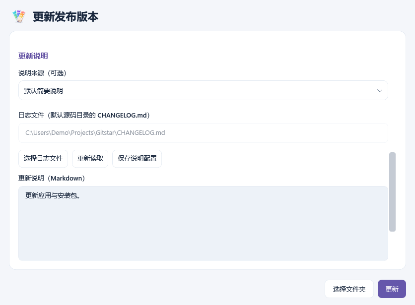
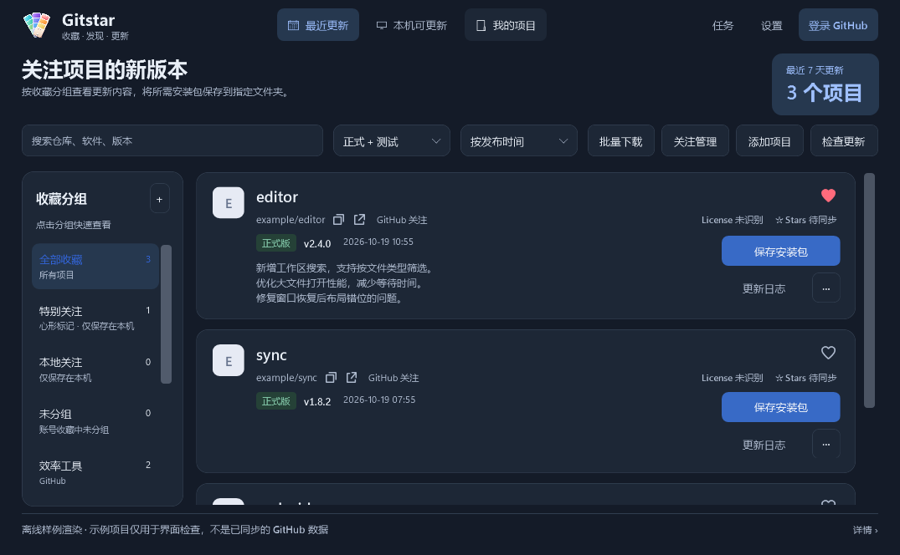

# Gitstar

[](LICENSE)

**收藏好项目，跟进新版本，打理自己的发布。**

Gitstar 是一款 Windows 桌面应用，把 GitHub 关注项目、本机软件更新和自己的项目发布放进同一个工作台。你可以按分组看看收藏的软件出了什么新版本，为电脑上的软件下载更新，也可以提交自己的源码、管理安装包与发布说明。

当前版本：**2.0.5** · 作者：[HuoXiaolin](https://github.com/HuoXiaolin) · [下载发行版](https://github.com/HuoXiaolin/Gitstar/releases)

[最近一次更新](CHANGELOG.md) · [历史更新日志](CHANGELOG_HISTORY.md)

## Gitstar 能做什么

### 跟进收藏项目的新版本

收藏之后，更新也能集中查看。在“最近更新”中浏览 GitHub Star 和本地关注的项目，翻阅更新日志，挑选需要的安装包。

- 按 GitHub 收藏分组或本地分组浏览，支持搜索、正式版与测试版筛选，以及按发布时间或仓库更新时间排序。
- 点亮卡片右上角的心形，将重点项目加入“特别关注”；再次点击即可移出，选择会保存在本机。
- 查看仓库许可证和 Stars，复制项目地址或打开主页；选择最新版本，也可下载历史版本的安装包；默认推荐适合当前电脑的文件，仍可展开更换。
- 按最近一段时间和文件类型批量收集发行包，下载文件保留原名。
- 新配置默认只保留最新安装包；首次下载提示实际保存目录与保留规则，可前往设置修改，此提示在本机只出现一次。
- 建议保留一份最新安装包，便于重装和离线备用；仓库删除或发行附件下架后，仍有本地副本可用。
- 统一管理 Star、本地关注和分组，支持关注列表导入导出，以及取消关注后的历史恢复。

### 看看这台电脑的软件能否更新

在“本机可更新”中，将已安装的软件或便携软件关联到 GitHub 项目，对比本机版本和远端版本，再决定什么时候更新。

- 自动推荐仓库匹配，也可手动修正；添加便携软件时选择 EXE 或软件文件夹，再关联仓库即可，名称、版本与目录自动读取。
- 按实际安装位置和主程序记录版本；安装器升级后即使更换登记标识，也能沿用原有关联，整理同一安装位置的重复记录，并保留检查与提醒设置。
- 区分同名软件的多份安装，可从运行中的程序选择真正使用的副本；版本来源可核对，必要时按应用关于页确认，文件变化后重新判断。
- 安装版可下载 EXE/MSI 并按提示打开安装器；便携软件支持一键替换 EXE 或 ZIP 中的程序文件，保留配置与个人数据，可选择备份旧程序，默认不备份。
- 便携更新可选择“自动替换并启动”，关闭已关联的软件、替换后从原路径重新打开；也可继续使用手动替换方式。
- 在“软件管理”中多选或全选，统一忽略当前版本、暂停检查、停止检查、恢复提醒或解除关联。
- 在“软件管理 → 核对软件”检查路径变化和疑似卸载的软件记录，选择新位置修复，或确认删除过期记录；支持多选，保留软件文件与安装包。

### 管理自己的源码与发布版本

“我的项目”把仓库、本地源码和发行目录关联起来，让日常提交与发布更顺手。

- 管理公开、私有项目，配置项目说明、主页和仓库功能，关联或克隆本地源码目录。
- 检查源码变更，选择提交文件并推送，核对本地与远端的同步状态。
- 从已构建的发行目录选择上传文件，读取应用版本号，更新正式版、测试版或草稿，并管理发布版本与附件。
- 更新说明可读取 `CHANGELOG.md`、指定其他文件或手动填写；未设置时自动使用简要说明。
- 保存配置后，支持单项目或批量“同步并发布最新”，自动提交源码并上传选定的发行文件。
- 上传显示进度条、已传大小、平均速度和耗时，区分发送完成与等待 GitHub 确认；支持取消与无进展检测。

### 适合日常使用的小功能

点击右上角账号名称可查看账号资料与授权信息，在窗口右下角退出登录或重新获取授权。

顶部“消息”集中查看 GitHub Notifications，有未读时在按钮右上角显示红点。支持未读/全部消息、本页搜索和分页，可预览 Issue、Pull Request、版本发布等消息的正文或最新回复，点击按钮或双击消息在浏览器查看。消息默认跟随软件更新检查刷新；设置中可独立选择仅手动、5/15/30 分钟或 1/2/6 小时，仍遵守服务器的最短请求间隔。预览不标记已读，消息正文不写入本地缓存。受限凭据或不支持的消息类型可在浏览器继续查看。

[消息预览界面（隔离演示数据）](docs/screenshots/github-notifications.png)

通知不等于仓库的全部 Issue。消息窗口可切换到“我的仓库 Issues”，查看当前账号名下仓库的问题，并筛选是否包含已关闭项、预览正文或在浏览器打开。

浅色与深色主题、托盘后台运行、开机静默启动、可调整频率的自动检查，以及可暂停、继续或取消的任务管理。设置中还能查看本地数据位置，按模块清理缓存和记录。

## 功能截图

以下截图由 **2.0.0 的隔离演示模式**生成，仓库、软件、版本及 Stars 等均为测试数据，仅用于展示功能。点击图片可查看原图。

| 最近更新 | 本机可更新 |
| --- | --- |
| [](docs/screenshots/recent-updates.png) | [](docs/screenshots/local-updates.png) |

| 我的项目 | 更新发布版本 |
| --- | --- |
| [](docs/screenshots/my-projects.png) | [](docs/screenshots/release-update.png) |

| 软件管理 | 深色模式 |
| --- | --- |
| [](docs/screenshots/software-management.png) | [](docs/screenshots/dark-mode.png) |

## 开始使用

1. 准备 Windows x64 环境，并安装 **.NET Desktop Runtime 10.x**。
2. 从 [Releases](https://github.com/HuoXiaolin/Gitstar/releases) 下载 `Gitstar-setup.exe` 安装，或直接运行单文件 `Gitstar.exe`。
3. 登录 GitHub 同步收藏，或添加公开仓库作为本地关注；进入“本机可更新”关联软件，进入“我的项目”配置源码和发行目录。

首次 GitHub 授权需要配置 OAuth App 并启用 Device Flow，步骤见 [使用说明](docs/Gitstar使用说明.md)。源码提交和推送需要安装 Git for Windows。

配置与缓存保存在本机，GitHub 登录凭据使用 Windows DPAPI 加密保存。可在设置中查看数据目录和清理选项。

## 从源码构建

项目使用 **WPF + .NET 10**。安装 .NET SDK 10 后，在源码根目录执行：

```powershell
dotnet build windows/Gitstar.slnx -c Release
dotnet run --project windows/Gitstar.Checks -c Release
```

生成发行文件：

```powershell
powershell.exe -NoProfile -ExecutionPolicy Bypass -File windows/build.ps1 -Dotnet "你的 dotnet.exe 路径"
```

生成安装版需准备 Inno Setup，可通过 `-Inno` 指定编译器路径。发行目录直接保存 EXE、安装包、使用说明、许可证和校验清单。

本项目的开发目录为 `D:\Agant\github-update`；构建后，最新精简源码同步到 `D:\Agant\Github_Source\Gitstar`，发行文件输出到 `D:\Agant\Github_Releases\Gitstar`。可通过 `-SourceRoot` 和 `-OutputRoot` 自定义输出位置。

通过 `windows/build.ps1` 生成安装包时，按北京时间的自然日判断，每天首次成功打包将第三段版本号加 1，例如 `2.0.0 → 2.0.1`，当天再次打包保持不变。版本号和最后成功打包日期一起保存在 `windows/Directory.Build.props`，清理构建缓存不会重复加号。构建失败、缺少安装器编译器或只运行 `dotnet build/publish` 时不递增。程序及安装包使用同一版本，Windows 数字文件版本对应为 `2.0.1.0`。

可运行 `powershell.exe -NoProfile -ExecutionPolicy Bypass -File windows/check-build-version.ps1`，用隔离的编译器和安装器替身核对日期、失败重试、版本同步及并发锁规则；此检查不会重新生成正式安装包。

## 支持项目

感谢你使用 Gitstar。如果它让你跟进开源软件、管理本机更新或发布项目更省心，欢迎点个 Star，也可以自愿赞助支持。

赞助将用于补贴开发和维护中的 **AI Token 等工具开销**，也为持续改进提供动力。金额随意，感谢每一份支持；反馈问题、提出建议同样是在帮助项目。

| 支付宝 | 微信支付 |
| :---: | :---: |
|  |  |

## 开源许可

Copyright (C) 2026 HuoXiaolin。Gitstar 采用 [GNU GPL v3.0](LICENSE)（`GPL-3.0-only`）发布。
